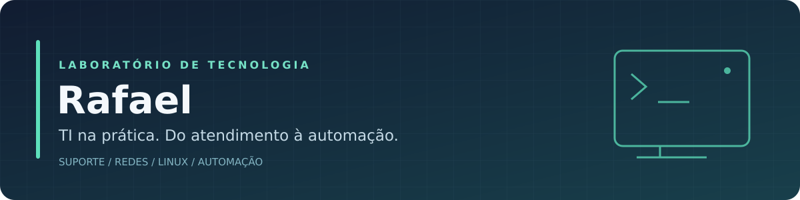

<picture>
  
</picture>

## Olá, eu sou o Rafael

Trabalho com TI na prática: suporte a usuários, manutenção de equipamentos, redes e ambientes Windows e Linux. Gosto de entender o problema, testar possibilidades e encontrar uma solução que facilite a rotina.

Este GitHub é meu laboratório: um lugar para organizar experiências, documentar procedimentos e compartilhar ferramentas que nascem de necessidades reais. Uso scripts e IA como apoio para criar, revisar e testar os projetos.

### O que você encontra por aqui

| Área | Meu foco |
| --- | --- |
| **Suporte e infraestrutura** | Computadores, notebooks, impressoras, acesso remoto e atendimento técnico. |
| **Redes** | Diagnóstico de conexão, testes de desempenho e ferramentas para a rotina de suporte. |
| **Linux e Windows** | Instalação, configuração, scripts e adaptação de ferramentas ao uso diário. |
| **Automação e Helpdesk** | Fluxos de chamados, integrações, organização de materiais e tarefas repetitivas. |
| **Documentação** | Guias, procedimentos e registros do que foi testado e do que ainda precisa melhorar. |

### Projetos

**[ResetExplode Linux](https://github.com/Rafael-Chaves-Laboratorio/ResetExplode-Linux)**

Aplicativo comunitário para monitorar hardware, acompanhar memória e processos, organizar jogos e executar testes no Linux. Inclui um motor próprio de teste de velocidade, sem exigir outro programa de speedtest. Em desenvolvimento, com limitações e validações documentadas no repositório.

**[Guia de testes](https://github.com/Rafael-Chaves-Laboratorio/guia-de-testes)**

Repositório de laboratório para organizar testes e experiências.

### Em que estou trabalhando

- Melhorar ferramentas de diagnóstico e monitoramento para Linux.
- Automatizar etapas da rotina de suporte e Helpdesk.
- Tornar instalação, uso e documentação mais simples para quem precisa resolver um problema.

---

**Aprender, testar, ajustar e compartilhar.**
